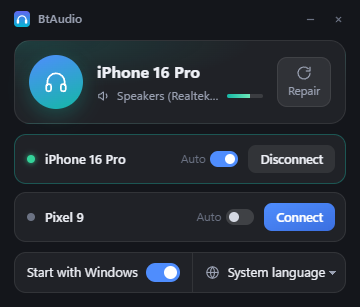
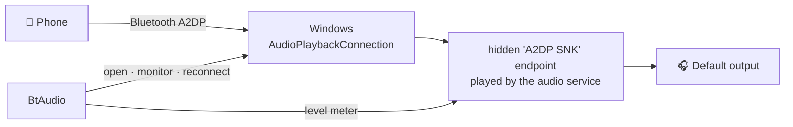

<div align="center">


# BtAudio

**Use your Windows PC as a Bluetooth speaker for your phone. Keep your headphones on at your desk and still hear your phone.**

[](https://github.com/a27259954/btaudio/actions/workflows/ci.yml)
[](https://github.com/a27259954/btaudio/releases/latest)
[](https://github.com/a27259954/btaudio/releases)
[](go.mod)
[](#requirements)
[](LICENSE)

English · [繁體中文](docs/README.zh-TW.md)



</div>

---

BtAudio is a single `btaudio.exe` that sits in the tray. Your phone streams music, videos and notifications over Bluetooth, and the PC plays them through its current speakers or headphones. It uses the A2DP receiver that Windows already has (`AudioPlaybackConnection`), so it needs no driver, no install and no extra hardware.

## Contents

- [Features](#features)
- [Requirements](#requirements)
- [Quick start](#quick-start)
- [When there is no sound](#when-there-is-no-sound)
- [How it works](#how-it-works)
- [FAQ](#faq)
- [Building from source](#building-from-source)
- [Contributing](#contributing)

## Features

| | |
|---|---|
| 🎧 **Phone audio on your PC** | iPhone or Android, any app. Sound goes to the Windows output you are already using. |
| 🔁 **Stays connected** | Each phone can connect automatically. After a drop BtAudio reconnects with a short back-off (2 s → 30 s). |
| 🩹 **One-click repair** | Windows sometimes keeps the link up but plays only silence. **Repair** swaps in a fresh connection in about 3 seconds, and the phone stays connected while it does. |
| 📊 **Live level meter** | Shows whether sound is actually arriving from the phone. |
| 🪶 **Small and quiet** | One ~10 MB exe with no cgo. It lives in the tray, can start with Windows, and keeps its settings in one JSON file. |
| 🌐 **Localized** | English, 简体中文, 繁體中文, Español, 日本語, 한국어. Follows the Windows display language, or pick one in the window. |

## Requirements

- Windows 10 version 2004 or later, or Windows 11, with the [WebView2 runtime](https://developer.microsoft.com/microsoft-edge/webview2/) (Windows 11 already includes it).
- A Bluetooth adapter, built in or USB.
- A phone that is **paired** with the PC.

## Quick start

1. **Pair the phone** in *Settings → Bluetooth & devices → Add device*. You only need to do this once.
2. **Download** [`btaudio.exe`](https://github.com/a27259954/btaudio/releases/latest/download/btaudio.exe) and run it.
3. Click **Connect** next to your phone. Play something, and it comes out of the PC.

Connecting turns on **Auto** for that phone, so BtAudio reconnects it whenever it comes back in range. **Disconnect** turns Auto off. Closing the window hides BtAudio to the tray. Right-click the tray icon to connect, repair or quit.

## When there is no sound

Sometimes Windows keeps the connection open but its audio pipeline only produces silence. The level meter then stays flat while the phone is playing. Click **Repair**, in the window or in the tray menu. BtAudio closes the connection and opens a new one, retrying up to three times, and the phone shows as connecting the whole time.

The repair stays manual on purpose. A paused phone and a stalled stream look the same to Windows (an active stream with zero level), and the phone does not report whether it is playing. Repairing automatically would mean reconnecting every time you pause.

## How it works



| Package | Responsibility |
|---|---|
| `internal/audio` | Windows audio stack without cgo: WinRT `AudioPlaybackConnection` (list, open, state, close) and COM/WASAPI for the default output and the stream's level meter. |
| `internal/core` | Connection logic behind a `Backend` interface: auto-connect, drop detection with a grace period, back-off, and repair. Unit-tested with a fake backend. |
| `internal/config` | Settings in `%APPDATA%\BtAudio\config.json`. |
| `internal/lang` | Language resolution and tray strings. |
| `main.go`, `tray.go`, `service.go` | Wails window, tray menu and the API used by the UI. |
| `frontend/` | Plain JavaScript and CSS, with no framework and no UI kit. Strings are in `src/i18n.js`. |

## FAQ

<details>
<summary><b>Can I take phone calls through the PC?</b></summary>

No. Calls use the Bluetooth hands-free profile, which Windows does not expose to apps. Use Windows **Phone Link** for calls. It can run alongside BtAudio.
</details>

<details>
<summary><b>"In use by another app"</b></summary>

Another Bluetooth receiver app holds the phone's audio connection. Close it and click **Connect** again.
</details>

<details>
<summary><b>"Timed out" or "The phone didn't respond"</b></summary>

Make sure the phone is nearby and Bluetooth is on. If it keeps failing, open the phone's Bluetooth settings and tap the PC to reconnect it once.
</details>

<details>
<summary><b>Command-line options</b></summary>

- `--hidden` starts in the tray. Start with Windows uses it.
- `--quit` closes a running BtAudio cleanly and closes its connections first.
</details>

<details>
<summary><b>Windows SmartScreen warns about the exe.</b></summary>

Release builds are not code-signed. Check the file against the `btaudio.exe.sha256` published with each release, then choose *More info → Run anyway*.
</details>

<details>
<summary><b>How do I uninstall it?</b></summary>

Turn off **Start with Windows**, quit from the tray, then delete `btaudio.exe` and `%APPDATA%\BtAudio`.
</details>

## Building from source

Requirements: Go 1.25+, Node 20+, and the Wails v3 CLI.

```bash
go install github.com/wailsapp/wails/v3/cmd/wails3@v3.0.0-beta.28
```

```bash
wails3 build
```

The output is `bin/btaudio.exe`. During development, use hot reload:

```bash
wails3 dev
```

To run vet, the tests and the i18n check:

```bash
wails3 task check
```

Every push to `main` publishes a release automatically. See [docs/CONTRIBUTING.md](docs/CONTRIBUTING.md#releases).

## Contributing

Issues and PRs are welcome. Please read [docs/CONTRIBUTING.md](docs/CONTRIBUTING.md) first: the project deliberately stays small.

## License

[MIT](LICENSE) © 2026 a27259954
