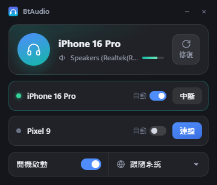
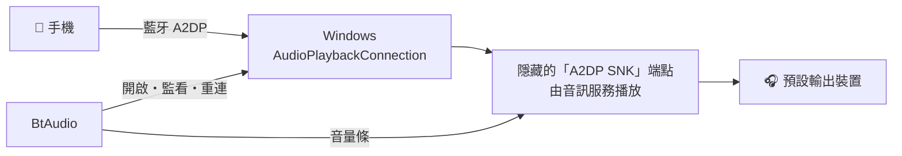

<div align="center">


# BtAudio

**讓 Windows 電腦變成手機的藍牙喇叭。戴著電腦的耳機，也能聽到手機的聲音。**

[English](../README.md) · 繁體中文



</div>

---

BtAudio 是單一執行檔 `btaudio.exe`，平常待在系統匣。手機透過藍牙送出的音樂、影片、通知音，會從電腦目前的喇叭或耳機播出來。它使用 Windows 內建的 A2DP 接收功能（`AudioPlaybackConnection`），不需要驅動程式、不需要安裝，也不用額外的硬體。

## 功能

- **手機聲音從電腦播放**：iPhone、Android 都可以，任何 App 都適用，聲音會走你在 Windows 正在使用的輸出裝置。
- **保持連線**：每支手機都可以設定自動連線。斷線後會自動重連，間隔從 2 秒逐步拉長到 30 秒。
- **一鍵修復**：Windows 偶爾會在連線還在的情況下只播出靜音。按「修復」大約 3 秒就會換上新的連線，過程中手機不會變成未連線。
- **即時音量條**：一眼就能看出手機的聲音有沒有真的傳進來。
- **輕巧**：單一執行檔約 10 MB，不使用 cgo。常駐系統匣、可開機啟動，設定只存在一個 JSON 檔裡。
- **多國語言**：支援 English、简体中文、繁體中文、Español、日本語、한국어。預設跟隨 Windows 顯示語言，也可以在視窗裡切換。

## 需求

- Windows 10 2004 以上或 Windows 11，需要 [WebView2 Runtime](https://developer.microsoft.com/microsoft-edge/webview2/)（Windows 11 已內建）。
- 藍牙介面卡（內建或 USB 都可以）。
- 手機已和電腦**完成配對**。

## 快速開始

1. **配對手機**：到「設定 → 藍牙與裝置 → 新增裝置」配對，只需要做一次。
2. 從[最新版本](https://github.com/a27259954/btaudio/releases/latest)**下載** `btaudio-vX.Y.Z.exe` 並執行。
3. 按手機旁的「**連線**」，接著播放任何聲音，就會從電腦播出來。

按「連線」會同時開啟那支手機的「**自動**」連線，之後手機回到附近時就會自動連上；按「中斷」會關閉自動連線。關閉視窗時 BtAudio 會縮到系統匣，在系統匣圖示上按右鍵可以連線、修復或結束。

## 沒有聲音時

Windows 有時候會讓連線維持著，但音訊處理流程只輸出靜音，這時手機明明在播放，音量條卻完全不動。請按「**修復**」（視窗裡或系統匣選單都有）。BtAudio 會關閉連線再重新建立，最多重試三次，過程中手機一直顯示「連線中」。

修復刻意設計成手動操作。對 Windows 來說，手機暫停播放跟串流卡住看起來完全一樣（串流作用中、音量為 0），手機也不會回報自己是否正在播放。如果改成自動修復，每次暫停都會被重新連線。

## 運作方式



| 套件 | 職責 |
|---|---|
| `internal/audio` | 不使用 cgo 呼叫 Windows 音訊：WinRT `AudioPlaybackConnection`（列出、開啟、狀態、關閉），以及用 COM/WASAPI 取得預設輸出裝置與串流音量。 |
| `internal/core` | 連線邏輯，透過 `Backend` 介面與平台分離：自動連線、含寬限期的斷線偵測、重試間隔、修復。用假的 backend 做單元測試。 |
| `internal/config` | 設定檔 `%APPDATA%\BtAudio\config.json`。 |
| `internal/lang` | 語言判斷與系統匣文字。 |
| `main.go`、`tray.go`、`service.go` | Wails 視窗、系統匣選單、提供給介面的 API。 |
| `frontend/` | 純 JavaScript 和 CSS，沒有使用框架或 UI 套件。介面文字在 `src/i18n.js`。 |

## 常見問題

<details>
<summary><b>可以用電腦接聽手機電話嗎？</b></summary>

不行。通話使用藍牙免持（HFP）協定，Windows 沒有開放給一般 App 使用。通話請用 Windows 內建的「**手機連結**（Phone Link）」，它可以和 BtAudio 同時使用。
</details>

<details>
<summary><b>顯示「被其他程式佔用」</b></summary>

有其他藍牙接收 App 佔用了手機的音訊連線。請把它關掉，再按一次「連線」。
</details>

<details>
<summary><b>顯示「連線逾時」或「手機沒有回應」</b></summary>

請確認手機在附近而且藍牙已開啟。如果一直失敗，到手機的藍牙設定裡點一下這台電腦，手動重新連線一次。
</details>

<details>
<summary><b>命令列參數</b></summary>

- `--hidden`：啟動時直接縮到系統匣（開機啟動就是用這個參數）。
- `--quit`：讓執行中的 BtAudio 正常結束，結束前會先關閉連線。
</details>

<details>
<summary><b>Windows SmartScreen 跳出警告</b></summary>

發佈的執行檔沒有程式碼簽章。請用同一個版本附上的 `.sha256` 檔核對檔案，再選「其他資訊 → 仍要執行」。
</details>

<details>
<summary><b>怎麼移除？</b></summary>

先關閉「開機啟動」，從系統匣結束程式，再刪除執行檔和 `%APPDATA%\BtAudio` 資料夾即可。
</details>

## 從原始碼建置

需要 Go 1.25+、Node 20+ 和 Wails v3 CLI：

```bash
go install github.com/wailsapp/wails/v3/cmd/wails3@v3.0.0-beta.28
```

```bash
wails3 build
```

產出的檔案是 `bin/btaudio.exe`。開發時可以用熱重載：

```bash
wails3 dev
```

執行 vet、測試和多語言檢查：

```bash
wails3 task check
```

每次推送到 `main` 都會自動發佈新版本，詳見 [CONTRIBUTING.md](CONTRIBUTING.md#releases)。

## 參與貢獻

歡迎提出 Issue 和 PR，請先閱讀 [CONTRIBUTING.md](CONTRIBUTING.md)。安全性問題請依 [SECURITY.md](SECURITY.md) 私下回報，不要開公開 Issue。

## 授權

[MIT](../LICENSE) © 2026 a27259954
